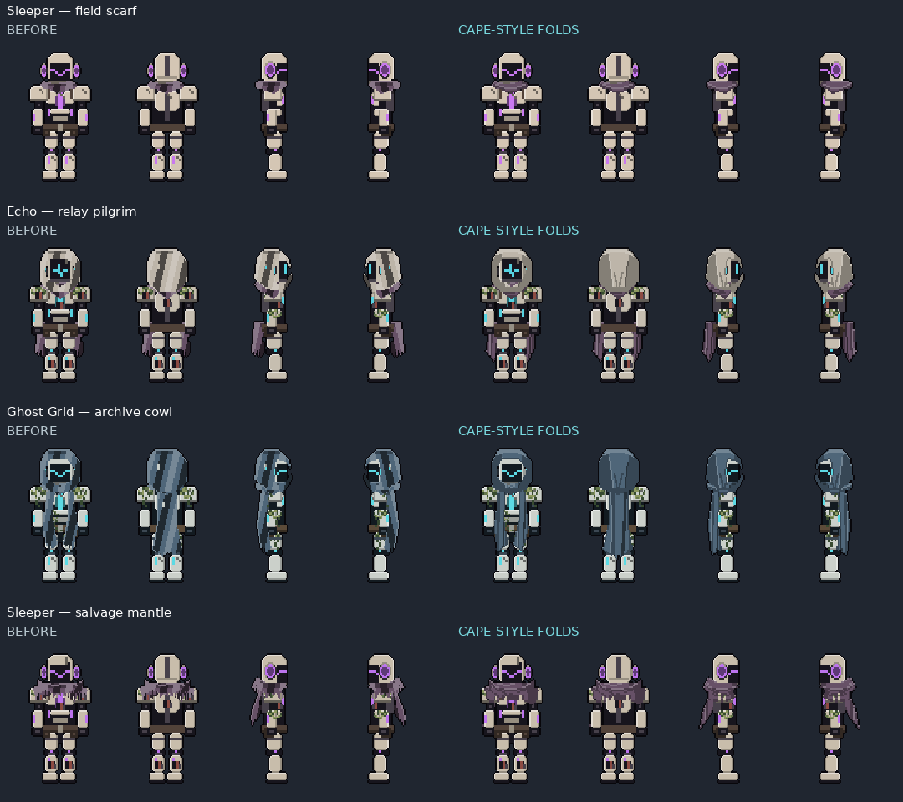

# Cloth refinement toward the existing capes

The optional wardrobe renderer now uses garment-specific folds instead of the same repeating diagonal/vertical sine bands on every piece. Work stays on `sprite-studio-sleek-copy`; the original game and original cape renderer are preserved.

- Scarves/cowls and shoulder wraps use curved, overlapping folds with a dark underside.
- Raised hoods use a lit crown, broad side shadows, a recessed face rim and creases gathering toward the nape.
- Long tabards, scarf tails and split drapes use broad cape-like light planes and restrained fold valleys. Wind displaces the cloth mask and shading together, increasing toward the free end.
- Outer fabric edges are dark; highlights are selective instead of tracing every edge brightly.
- Frayed hems use coherent notches; small holes stay attached to garment coordinates as the body bobs.
- Existing colors, wardrobe controls, save format, face panel, moss, damage and animation poses are retained.

## Visual review



The first local revision made the hood backs too blank; a second pass added gathered creases and broader side planes. The final result separates scarves, hoods and hanging cloth more clearly and removes the strongest striped appearance. The simple procedural body and low-resolution hood silhouettes remain limitations. These are still prototype sprites rather than the detailed reference characters.

`wardrobe-options.gif` shows the refined options alone. These previews composite the actual native frame PNGs with nearest-neighbor display scaling; they are not repainted or AI-generated images. The before renders match source checkpoint `4e69ac187653446e1235001dd3bd1d6196fd8ba0`.

## Validation

Local native suite: **22 checks passed**, plus production build and `git diff --check`.

- 1,320 original Classic render comparisons remain pixel-exact.
- 1,320 Sleek renders and 576 wardrobe cases retain binary alpha and nonempty output.
- 48 direct comparisons against the previous checkpoint prove the existing cape/body pixels are unchanged at both native sizes, in all four directions and all six walk frames.
- A translation test confirms cloth shading/wear moves with body bob rather than crawling over the garment.
- Existing visor continuity, face protection from growth, rig pivots, edited pixels, project reopening and export checks remain enabled.

The branch workflow also runs real Chromium UI/save/download checks. See the latest CI run for the remote result. Existing phone editor crowding remains open.

Reproduce from frontend:

```sh
STUDIO_REVIEW_OUT=/tmp/cloth-polish npm run test:studio
python tools/make-wardrobe-review.py /tmp/cloth-polish ../docs/sprite-studio-cloth-polish
```

For before/after composition, run `tools/make-cloth-comparison.py BEFORE_RENDER_FOLDER AFTER_RENDER_FOLDER OUTPUT_FOLDER` with Pillow installed. Each render folder must contain the native test's frame PNGs and preview index. Keep the previous checkpoint for future comparisons; do not merge this copy into main automatically.
