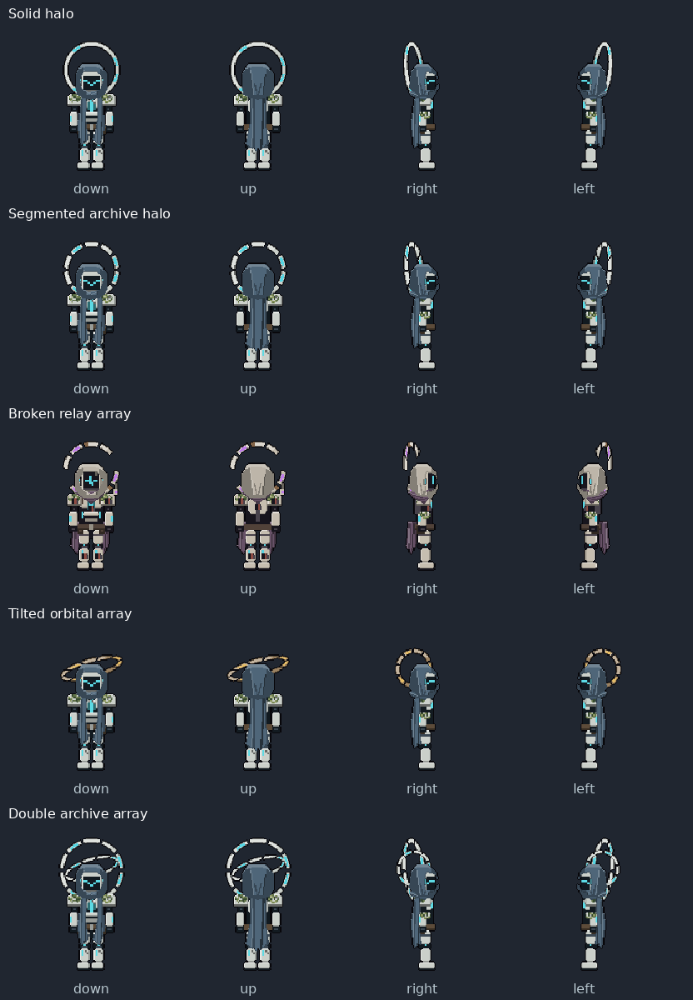

# Echo and Ghost Grid ring arrays

Optional humanoid arrays on the isolated `sprite-studio-sleek-copy` branch. These complement the existing part-based machine-ring renderer. Original main and machine presets stay unchanged.

| Control | Options |
| --- | --- |
| Ring array | None, continuous halo, segmented halo, broken relay array, tilted orbital ring, double array |
| Size | Compact, standard, large |
| Band width | 1–3 |
| Segments | 6–16 |
| Ring light | 0–3; separate light color |
| Ring damage | 0–3; missing panels and localized weathering |
| Motion | Steady, light pulse, gentle drift |
| Hanging data tags | Optional; tags attach only to surviving ring panels |
| Metal color | Independent from the body armor |

Broken arrays retain a base fracture even at damage 0. Halo metal remains continuous until damage is applied; segment count also controls its light spacing. All arrays render behind the head/body, with an ellipse/tilt appropriate to the profile view. The left profile uses the established mirrored-right convention.



## Canvas and engine integration

Rings need extra headroom and sometimes extra width. `fitRingCanvas(project, resizeSet)` expands both sprite sets with transparent pixels, anchored at the feet. It preserves the body scale, including fractional design scales on custom frame sizes. No body/leg shrinking is used. Extra horizontal growth is even so bottom-center pixel alignment stays exact.

`cfg.ringPadding` and `cfg.ringScales` persist through the current project JSON format. Turning rings off retains margins to protect edits there. Preset changes preserve this layout metadata. Old projects with no rings use the original sizing behavior. Protected hand-edited cells are repositioned with the canvas and remain protected from regeneration.

Use the exported PNG/JSON frame dimensions and bottom-center anchor. A visual frame can exceed a 32px tile; the collision/tile footprint stays unchanged. Do not crop ring sprites to a hardcoded 32×56 frame. Custom callers should fit the project before drawing a newly enabled ring.

## Validation and critique

Local native suite: **24 checks passed**, plus production build and syntax/diff checks.

- Existing 1,320 Classic exact comparisons, 1,320 Sleek alpha checks, 576 wardrobe renders and 48 cape/body comparisons remain enabled.
- 1,440 ring renders across five styles, three sizes, four directions, six walk frames and four base frame sizes have clean binary alpha and unchanged opaque body/face pixels.
- 1,200 expanded-canvas comparisons cover clipping, drift extremes and ±2-pixel combat/malfunction lean. Ring geometry is rendered on a larger canvas to detect pixels that would have been cropped.
- 40 extra light/damage/band-width extremes retain visible ring geometry, including light 0.
- Tests preserve edited pixels, body size, saved margins, bottom-center export anchors, and the tile footprint. Removing rings does not shrink the canvas.
- UI/save/reopen tests exercise ring selection and size fitting. The browser suite additionally tests the band-width control and downloaded ring-project reopening.

The initial bands looked too thin; the final controls support thicker metal panels. Segment gaps, glow bars and fractures read at native size, though very dense/compact arrays remain simplified. These are reusable prototype components, not exact reconstructions of the concept sheets. Existing body proportions and phone editor crowding remain open. The copy workflow also runs Chromium tests; consult its latest run for the remote result.

Reproduce from frontend:

```sh
STUDIO_REVIEW_OUT=/tmp/rings npm run test:studio
python tools/make-ring-review.py /tmp/rings ../docs/sprite-studio-rings
```

The preview compositor keeps the body scale consistent across differently padded frame sizes. Keep this work on the copy branch; no automatic merge into main.
