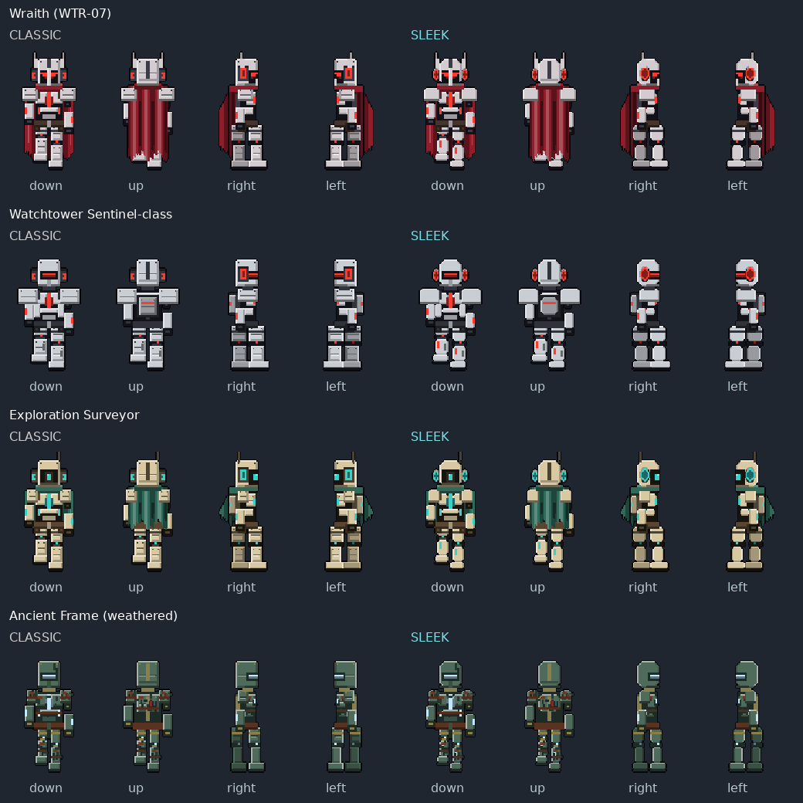
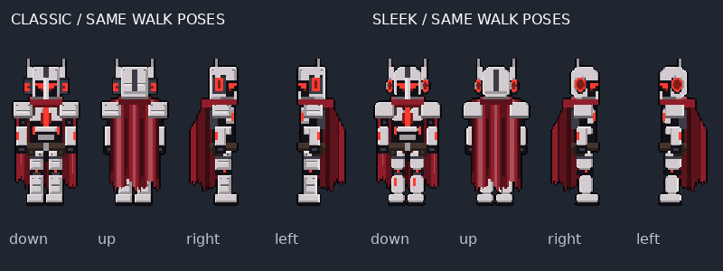
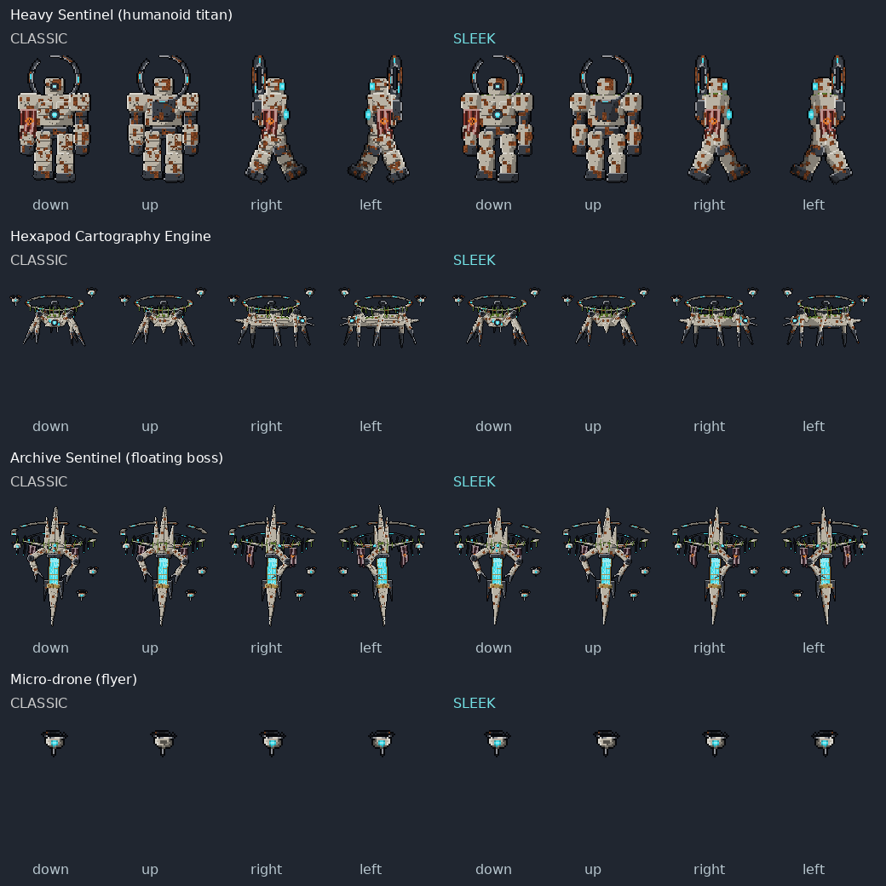

# Sprite Studio: isolated Sleek copy

This is an incremental upgrade to the **native procedural maker**, built on the working generator at `f6f8f09b7d6c452f158a67473ac35c2fb374da6f`. Work stays on `sprite-studio-sleek-copy`; do not merge into main automatically. The original game, converter, example configurations, skeletal transforms and animation key poses are outside this change.

## Result

- Humanoids: chamfered armor and helmet corners, gentle longitudinal taper, simpler highlights without repeated cross-panel seams, circular side-head displays, narrow shin light strips. Existing plate envelopes and joint positions stay fixed.
- Native `display` head: a small screen with a waveform, front/back/profile rendering through the existing rig. An original generic study, not a conversion of a reference character.
- Machines: optional Sleek surface shader for plate/taper parts, restrained surface noise, retained rust/moss/wear controls. Rings, cables, cloth, glass, imported texture pixels and part matrices remain on their existing paths.
- UI: Classic/Sleek controls; new humanoids start Sleek. Projects with no style property render Classic. Machine examples remain Classic until explicitly switched. A separate autosave key prevents this copy from replacing the original Studio's browser autosave on the same origin.
- Existing hand-edited cells remain protected during style changes because regeneration still operates on unedited cells.





## Critical visual review

The humanoid outlines are less rectangular and the larger armor surfaces read more cleanly. The machine difference is subtler at native size, particularly on thin hexapod legs. Sparse probes, rings and tiny drones are deliberately retained rather than being rounded into bulky parts. Ancient surfaces retain damage and overgrowth.

This remains a procedural prototype. It does **not** reproduce the fine silhouettes, bespoke hair, fabric construction or layered armor of the supplied concept sheets. The existing walk poses, default proportions and mirrored side-view convention remain visible. This pass does not claim to repair every original animation or create finished player characters. The next visual step is broader silhouette/part controls, evaluated on this copy, while retaining this baseline.

## Validation

Run with Node 24:

```sh
cd frontend
npm ci
npm run test:studio
npm run build
```

The native suite executes production renderer, editor and save/export modules using `@napi-rs/canvas` plus a jsdom DOM adapter. Dependencies are for development only; the shipped app still runs without runtime npm dependencies or paid APIs.

- Original baseline: 18 checks passed.
- Updated copy: 19 checks passed.
- 1,320 old-style renders match immutable original pixels exactly: four humanoid presets at two resolutions and five machine presets, sampled across their animation libraries and all four directions.
- 1,320 Sleek renders have binary alpha and nonempty output. Humanoid pose objects and machine pivot coordinates match the original.
- Imported texture rendering, edited-frame protection, project save/reopen, PNG sheet import/export, four-direction controls, independent exploration/battle sets and original example opening/generation pass.
- ZIP export was independently opened with Python's `zipfile`; file contents and CRC pass.
- Static production build and `git diff --check` pass.

`results-baseline.json` and `results-native.json` contain detailed outcomes. `frontend/tests/studio-regression.mjs` supplies a Playwright browser suite (`npm run test:studio:browser`; install a Playwright Chromium first). Browser launch in the current worker is blocked by a Unix-socket permission restriction, so **browser layout, real pointer input, mobile rendering and download dialogs have not been verified**. The DOM/native tests are not a substitute for those checks. A CI workflow runs native checks on this copy branch; remote CI status must be checked after pushing.

## Continuation rules

Keep main intact. Use the copy branch, compare against the immutable baseline, and preserve Classic. Do not silently restyle saved projects, change texture-based reference conversion, or overwrite edited frames. Keep previews inline when showing progress. Store tested results and limitations in Atlas Warehouse so later sessions can resume without repeating the failed manual animation approach.
