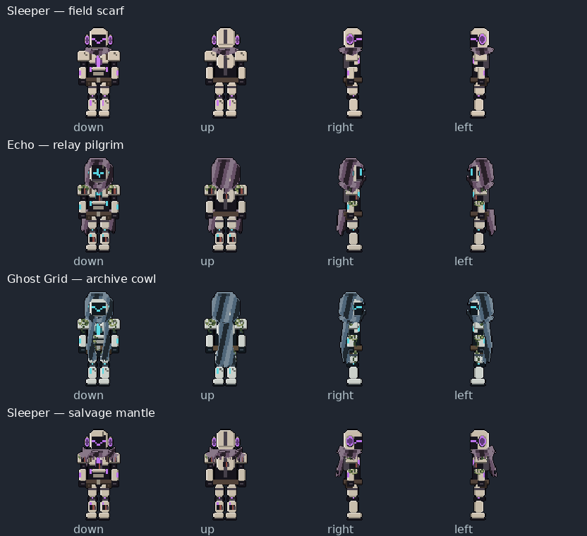

# Bearframe wardrobe and age controls

Continuation of the isolated `sprite-studio-sleek-copy` generator. Original main and the reference-to-sprite converter are preserved.

## Added

| Control | Choices |
| --- | --- |
| Face panel | Smooth continuous visor; optional legacy split |
| Scarf | None, wrap, trailing, cowl |
| Hood | None, raised, draped/lowered |
| Drapery | None, shoulder mantle, tabard, split hip drapes |
| Frayed cloth | 0–3: broken hems and small cloth holes; also roughens cloak hems |
| Overgrowth | 0–3: clustered moss on armor, short rooted vines at higher density |
| Damage pattern | Worn scratches, cracked plates, exposed inner mechanism, scorching |
| Damage amount | Existing 0–3 control sets severity |

These are independent configuration fields, not pre-baked outfits. Separate scarf, hood and drapery color controls allow an ivory hood with plum scarf/drapes, while existing controls recolor armor and lights. Four new presets demonstrate Sleeper field scarves/salvage mantles, an Echo relay pilgrim and a Ghost Grid archive cowl. They are generic native studies, not recreations of reference characters. Being old or damaged remains configurable rather than an automatic effect applied to every Bearframe.

New humanoids default to a smooth visor. Existing Sleek visor projects also render the connected panel unless explicitly set to Split. On opening an older Sleek project with no face choice, unedited frames are refreshed automatically; hand-edited frames remain protected. Old Classic projects with no new properties retain original pixels. The requested change removes the bright center nose/face divider; the dark display spans the front and profile, with a connected V expression on the front. The back helmet's mechanical strip is separate from the face and is preserved.

Clothing is rasterized as binary-alpha pixel geometry before/after the body as appropriate. Cloth holes reveal the body underneath instead of cutting holes through the character. Moss is masked to armor and its vines begin at painted growth roots; it never crosses the face display. Pose functions, limb positions, rig matrices, feet, tile anchors and imported textures are untouched. Edited cells stay protected during regeneration. New fields persist through the existing JSON project format.

## Review and evidence

The scarves, hood outlines and long drapes read as distinct choices at native resolution. Exposed mechanisms are small, localized gaps rather than detached body pieces. Hood folds and overgrowth are deliberately simplified to remain readable on the 32×56 design grid. The base body is still a procedural prototype: this does not reproduce the reference sheets' bespoke hair, layered armor or feminine body shapes. Left/right remain mirrored views. The previously documented cramped phone editor remains open.

Native validation: **21 checks passed**, including the original 1,320 pixel-exact Classic comparisons, 1,320 Sleek alpha checks, 576 wardrobe/wear/damage walking renders across four directions at 32×56 and 64×112, a specific no-center-strip assertion, a no-growth-on-face assertion, edited-frame protection and new configuration save/reopen. Production build and syntax checks passed. Chromium also passed **25 checks**, including wardrobe/color controls, old-Sleek visor refresh, preserved hand edits, project reopening, and actual PNG/JSON/ZIP downloads. Native checks, browser checks and production build passed in [CI run 43609986774](https://github.com/nobleknights015-maker/bearframe-ghost-signal/actions/runs/43609986774) at commit `f4f6fe7a007dd4ed33f94d018bc6927e864d5fd0`.

Run `STUDIO_REVIEW_OUT=/tmp/wardrobe npm run test:studio` from frontend, then compose the unmodified rendered frames with `python tools/make-wardrobe-review.py /tmp/wardrobe ../docs/sprite-studio-wardrobe` (Pillow required for composition only).

Implementation: `frontend/public/studio/lib/android-details.js`, `sprite-rig.js`, and the humanoid configuration panel in `studio.js`. Keep development on the copy branch. Do not merge into main automatically.
